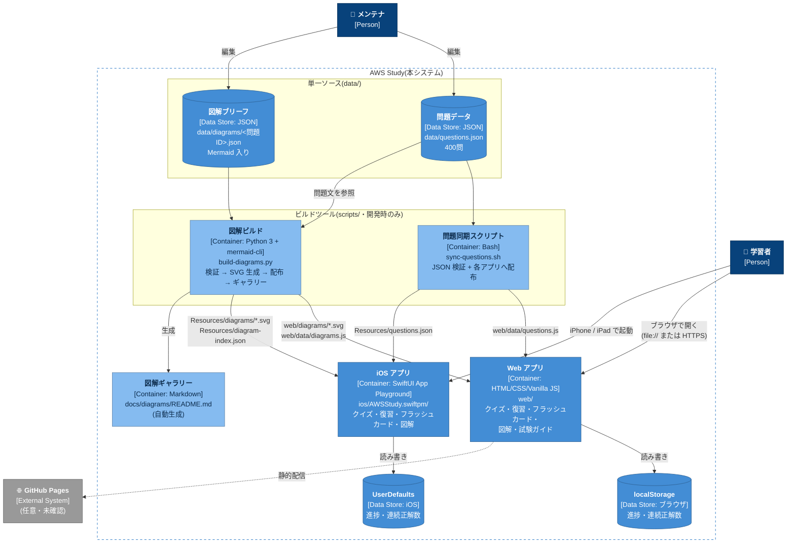

# AWS Study — ゼロコスト AWS 資格対策アプリ

## アーキテクチャ概要

サーバー・DB・外部 API を持たないゼロコスト構成。`data/` の単一ソースからビルドスクリプトで Web版・iOS版へ配布し、学習進捗は端末内にのみ保存する(C4モデル Level 2: Container 図)。



System Context / Component 図・データフロー・ディレクトリ構成の詳細は [docs/architecture.md](docs/architecture.md) を参照。

---

AWS 認定(SAA レベル)の勉強用クイズアプリ。**Web版**と**iOS版**の2つを同梱し、サーバー・課金要素なしで動作します。

- 問題: 400問 / 6カテゴリ(コンピューティング・ストレージ・ネットワーク・セキュリティIAM・データベース・サーバーレス運用)、全問に詳しい解説付き
- 難易度: level 1(基礎)60問 / level 2(応用)140問 / level 3(本試験レベル)200問
- 機能: ランダム10問クイズ / カテゴリ別クイズ / 弱点復習(間違えた問題だけ再出題) / フラッシュカード / 進捗・正答率・連続正解ストリーク

## 使い方

### Web版(すぐ使える)

```bash
open web/index.html
```

ブラウザで開くだけ。ビルド・サーバー不要。キーボード操作対応(1–4 で解答、Enter で次へ、フラッシュカードは Space / ←→)。
GitHub Pages で公開する場合は `web/` を公開ディレクトリに設定するだけです(無料)。

### iOS版

`ios/AWSStudy.swiftpm` を **Xcode** で開いて実行(シミュレータ or 実機)。iPad なら **Swift Playgrounds** アプリでも直接実行できます。
App Playground 形式のため、有料の Apple Developer Program は不要です(無料 Apple ID で実機インストール可)。

## リポジトリ構成

```
data/questions.json         問題データの単一ソース(編集はここだけ)
data/diagrams/<問題ID>.json  問題ごとの図解ブリーフ(単一ソース)
scripts/sync-questions.sh   Web / iOS へ問題データを配布
scripts/build-diagrams.py   図解の検証 + SVG生成 + Web/iOS へ配布 + ギャラリー生成
web/                        Web版(静的 HTML/CSS/JS + 生成済み SVG)
ios/AWSStudy.swiftpm/       iOS版(SwiftUI App Playground)
.claude/skills/zukai-creator/ 図解作成スキル(出典: github.com/53able/skills)
docs/architecture.md        アーキテクチャ図(毎時レビュー対象)
docs/DIAGRAM-WORKFLOW.md    問題図解の作り方・スキーマ・共通スタイル
docs/diagrams/README.md     問題図解ギャラリー(自動生成)
docs/RULES.md               運用規約(ブランチ運用・データ管理・レビュールーチン)
docs/archive/               旧計画ドキュメント(2026-07-04 時点の未実装構想)
```

## 問題を追加するには

1. `data/questions.json` に問題を追記(書式と品質基準は [docs/RULES.md](docs/RULES.md) 参照)
2. `scripts/sync-questions.sh` を実行
3. 生成物ごとコミット

## 問題の図解を追加するには

判断構造を1枚にまとめた図解を、問題ごとに付けていく(現在 3 問 / 400 問)。
図解は**ビルド時に SVG へ変換**され、クイズの解説欄に表示される(Web版・iOS版とも)。
アプリは出来上がった SVG を表示するだけなので、実行時の依存は増えない。

```bash
npm install                        # 初回のみ(mermaid-cli / 開発時だけの無料依存)
python3 scripts/build-diagrams.py  # 検証 → SVG生成 → Web・iOS へ配布 → ギャラリー生成
```

1. Claude Code で `zukai-creator` スキルを使い、`data/diagrams/<問題ID>.json` にブリーフを書く
2. `python3 scripts/build-diagrams.py` を実行(`--force` で全 SVG を再生成)
3. ブリーフと生成物をコミット

手順とスタイルルールの詳細は [docs/DIAGRAM-WORKFLOW.md](docs/DIAGRAM-WORKFLOW.md)、
できた図は[図解ギャラリー](docs/diagrams/README.md)で確認できる。
