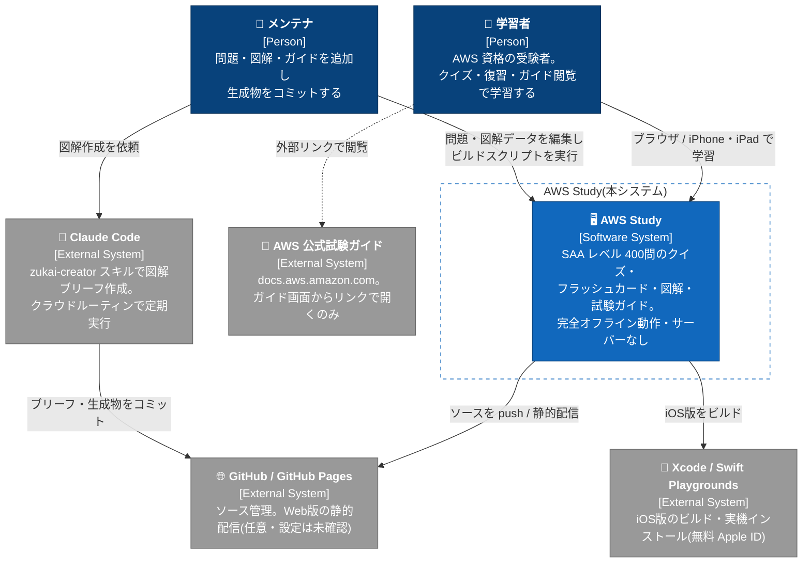
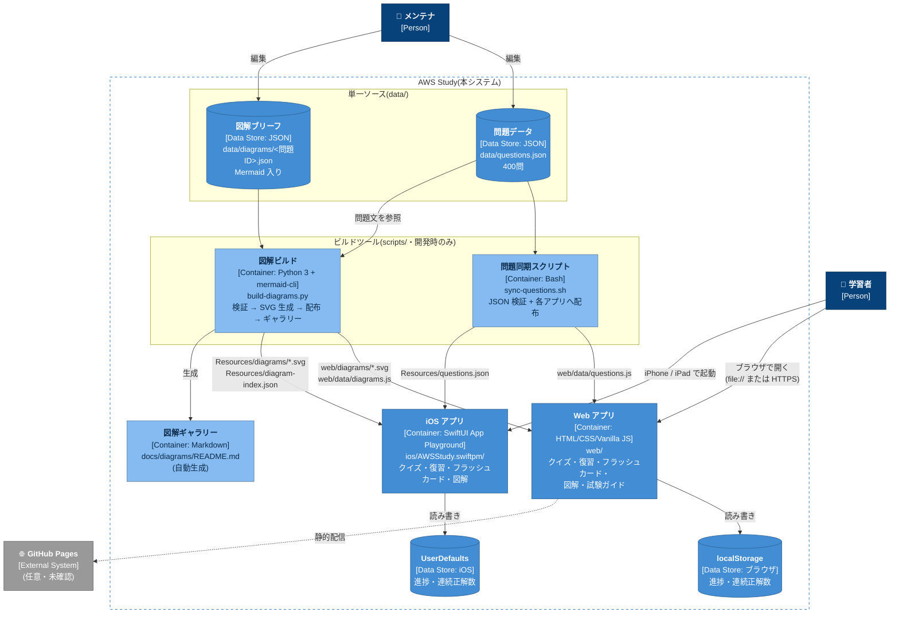
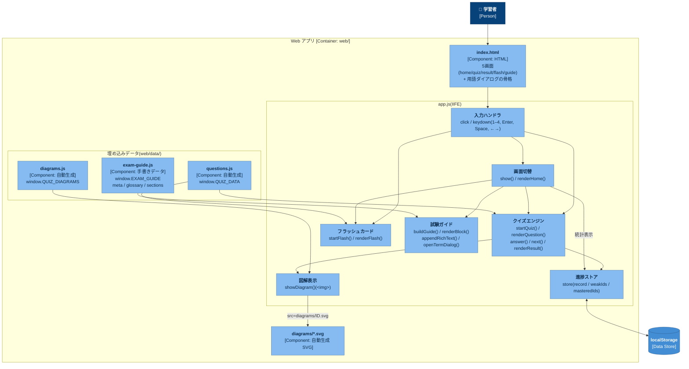
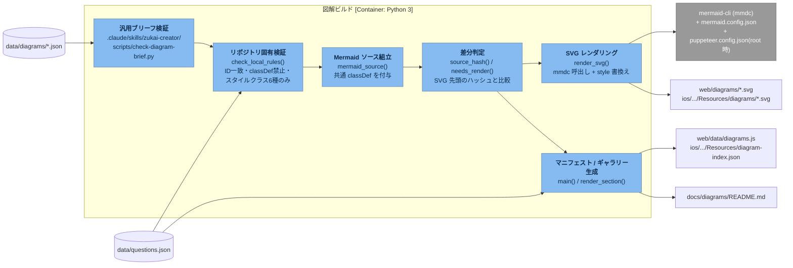
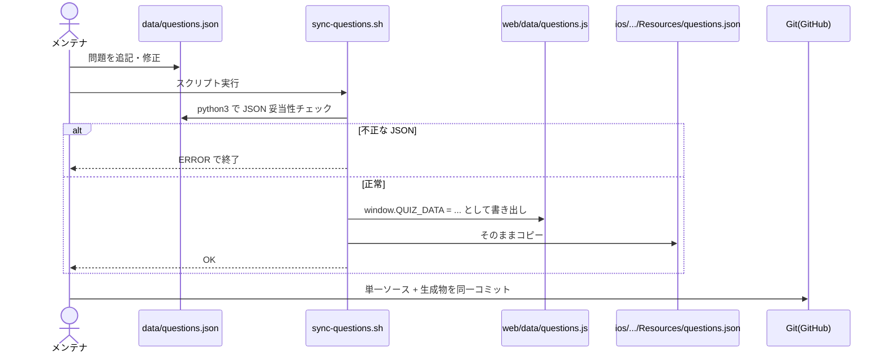
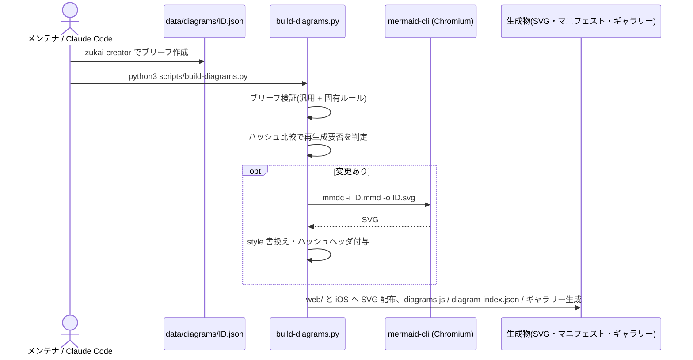
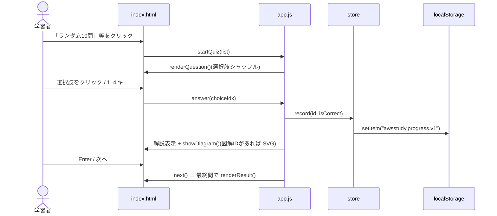

# アーキテクチャ(C4モデル)

最終レビュー: 2026-10-31(C4モデル形式に再構成。試験ガイド閲覧機能 `web/data/exam-guide.js` を反映。運用は [RULES.md](RULES.md) 参照)

> 記述はリポジトリ内のコードに基づく。コードから確認できない点は「未確認」と明記する。

## 概要

| 項目 | 内容 |
|---|---|
| 目的 | AWS 認定ソリューションアーキテクト – アソシエイト(SAA-C03)レベルの学習用クイズアプリ。400問・6カテゴリ・全問解説付き |
| 主な利用者 | AWS 資格の受験者(学習者)。加えて問題・図解を追加するメンテナ(開発者) |
| 方針 | **ゼロコスト**:サーバー・DB・認証・外部 API・課金要素なし。進捗は端末内のみに保存([RULES.md](RULES.md) 第2節) |
| 提供形態 | Web版(静的 HTML/CSS/JS)と iOS版(SwiftUI App Playground)の2クライアントを同梱 |

### 技術スタック

| 区分 | 技術 | 根拠 |
|---|---|---|
| Web フロントエンド | HTML / CSS / Vanilla JavaScript(ビルド・フレームワークなし) | `web/index.html`, `web/app.js`, `web/styles.css` |
| Web 永続化 | `localStorage`(キー `awsstudy.progress.v1`) | `web/app.js` |
| iOS アプリ | Swift 5.9 / SwiftUI / iOS 16+ / App Playground(`.swiftpm`、`AppleProductTypes`) | `ios/AWSStudy.swiftpm/Package.swift` |
| iOS 永続化 | `UserDefaults`(キー `awsstudy.progress.v1` / `awsstudy.streak.v1`) | `Models.swift` |
| iOS 図解表示 | WebKit(`WKWebView` に SVG を埋め込み) | `DiagramView.swift` |
| データ | JSON(`data/questions.json`、`data/diagrams/*.json`)、JS 埋め込みデータ(`web/data/exam-guide.js`) | `data/`, `web/data/` |
| ビルドツール | Bash(問題データ配布)、Python 3(図解検証・生成)、Node.js + `@mermaid-js/mermaid-cli` ^11.4.2(開発時のみ・内部で Chromium 起動) | `scripts/`, `package.json` |
| 図解作成支援 | Claude Code スキル `zukai-creator`(外部リポジトリ由来) | `.claude/skills/zukai-creator/` |
| CI / IaC / Docker | **なし**(`.github/`・Dockerfile・IaC ファイルは存在しない) | リポジトリ全体 |
| ホスティング | README 上は GitHub Pages(`web/` を公開)を想定。実際の公開設定は**未確認** | `README.md` |

---

## Level 1: System Context 図



| 名前 | 種別 | 技術 | 責務 |
|---|---|---|---|
| 学習者 | Person | ブラウザ / iOS 端末 | クイズ解答、弱点復習、フラッシュカード、試験ガイド閲覧 |
| メンテナ | Person | ローカル開発環境 | `data/` の単一ソースを編集し、`scripts/` で生成物を作ってコミット |
| AWS Study | Software System | 静的 Web + SwiftUI | 学習機能の提供。進捗は端末内のみに保存し、外部へ送信しない |
| GitHub / GitHub Pages | External System | Git ホスティング / 静的配信 | ソース管理。Web版の公開先候補(Pages の有効化状況は未確認) |
| AWS 公式試験ガイド | External System | Web ページ | `exam-guide.js` の出典。ガイド画面の「AWS 公式ガイドを開く ↗」リンク先。API 連携はなし |
| Xcode / Swift Playgrounds | External System | Apple 開発ツール | `.swiftpm` のビルド・シミュレータ / 実機実行 |
| Claude Code | External System | AI コーディングエージェント | 図解ブリーフ作成(`zukai-creator`)、図解作成・コードレビューの定期ルーティン(RULES.md 第7・8節) |

---

## Level 2: Container 図



| 名前 | 種別 | 技術 | 責務 |
|---|---|---|---|
| 問題データ | Data Store | JSON | 問題の単一ソース(`version` / `updatedAt` / `questions[]`。各問 `id, category, level, question, choices, answer, explanation`) |
| 図解ブリーフ | Data Store | JSON | 問題ごとの図解の単一ソース(zukai-creator 形式 + `question_id` + `mermaid`)。現在 233 件 |
| 問題同期スクリプト | Build Tool | Bash + Python(JSON 検証) | `questions.json` を `web/data/questions.js`(`window.QUIZ_DATA`)と iOS バンドルへ配布 |
| 図解ビルド | Build Tool | Python 3 + mermaid-cli(Chromium) | ブリーフ検証 → Mermaid を SVG に事前レンダリング(内容ハッシュで差分生成)→ Web/iOS へ配布 → マニフェストとギャラリー生成 |
| Web アプリ | Container | HTML / CSS / Vanilla JS | 静的 SPA。`<script>` で埋め込みデータを読み込み、`file://` でも動作(fetch 不使用) |
| iOS アプリ | Container | SwiftUI / WebKit | 同等の学習機能(試験ガイドは Web 版のみ実装)。図解は `WKWebView` で SVG 表示 |
| localStorage | Data Store | ブラウザストレージ | `{progress: {id: {attempts, correct, wrongStreak}}, streak}` を保存 |
| UserDefaults | Data Store | iOS 標準 | 進捗と連続正解数を保存(Web と同一スキーマ) |
| 図解ギャラリー | Document | Markdown(Mermaid) | GitHub 上で全図解を一覧できるレビュー用ページ |
| GitHub Pages | External System | 静的ホスティング | Web版の公開先候補(設定は未確認) |

---

## Level 3: Component 図

### 3-1. Web アプリ(`web/`)



| 名前 | 種別 | 技術 | 責務 |
|---|---|---|---|
| index.html | Component | HTML | 各画面の `<section>` と `<dialog id="term-dialog">`。データ → `app.js` の順に `<script>` を読み込む |
| questions.js | Component(生成物) | JS | `window.QUIZ_DATA`。`sync-questions.sh` が生成。編集禁止 |
| diagrams.js | Component(生成物) | JS | `window.QUIZ_DIAGRAMS`(図解を持つ問題ID一覧)。`build-diagrams.py` が生成。編集禁止 |
| exam-guide.js | Component | JS | SAA-C03 試験ガイドの要点・用語集。`[[termId\|表示]]` 記法で用語チップを埋め込む。Web 専用の単一ソース |
| diagrams/*.svg | Component(生成物) | SVG | 解説欄に表示する図解 |
| 画面切替 | Component | JS | `show(name)` で view を切替、ホームの統計・カテゴリ一覧を描画 |
| クイズエンジン | Component | JS | 出題(選択肢シャッフル)・採点・解説表示・結果画面・間違えた問題のやり直し |
| 図解表示 | Component | JS | `DIAGRAM_IDS` に含まれる問題のみ `` で SVG を表示(`file://` 対応のため存在確認に fetch を使わない) |
| フラッシュカード | Component | JS | 問題/答えの表裏表示と前後移動 |
| 試験ガイド | Component | JS | ガイド本文・目次・事実一覧を DOM 生成し、用語クリックでダイアログ表示 |
| 進捗ストア | Component | JS | `{attempts, correct, wrongStreak}` と連続正解数の記録。要復習=`wrongStreak>0`、習得済み=`correct≥2 && wrongStreak=0` |
| 入力ハンドラ | Component | JS | ボタンのクリックとキーボードショートカット |

### 3-2. 図解ビルド(`scripts/build-diagrams.py`)



| 名前 | 種別 | 技術 | 責務 |
|---|---|---|---|
| 汎用ブリーフ検証 | Component | Python(外部スキル同梱) | zukai-creator 形式としての妥当性チェック(サブプロセス実行) |
| リポジトリ固有検証 | Component | Python | `question_id` とファイル名・問題データの一致、`mermaid` 非空、`classDef` 混入禁止、許可クラス(`req/judge/best/alt/svc/note`)のみ |
| Mermaid ソース組立 | Component | Python | ブリーフの Mermaid に共通スタイル `CLASS_DEFS` を付与 |
| 差分判定 | Component | Python | ソース + 設定の SHA-256 先頭16桁を SVG ヘッダに埋め、変化時のみ再生成(`--force` で全再生成) |
| SVG レンダリング | Component | Python + mmdc | mermaid-cli で SVG 化し、`max-width` を外して幅追従させる。root 実行時のみ `--no-sandbox` |
| マニフェスト / ギャラリー生成 | Component | Python | Web/iOS 用の図解ID一覧と、問題文・正解・図を並べたギャラリー Markdown を生成 |

---

## 主要なデータフロー

### フロー1: 問題データの配布(メンテナ → 両アプリ)



### フロー2: 図解の追加(ブリーフ → SVG → 表示)



### フロー3: 学習者のクイズ解答(Web版)



iOS 版も同じ流れ(`HomeView` → `fullScreenCover` で `QuizView` → `ProgressStore.record()` → `UserDefaults`、解説下に `DiagramCard`)。

---

## ディレクトリ構成

```
.
├── README.md                     利用方法・リポジトリ概要
├── package.json / package-lock.json  開発依存(mermaid-cli)のみ
├── data/                         単一ソース
│   ├── questions.json            問題データ(400問)
│   └── diagrams/<問題ID>.json    図解ブリーフ(233件)
├── scripts/                      ビルドツール(開発時のみ)
│   ├── sync-questions.sh         問題データを Web / iOS へ配布
│   ├── build-diagrams.py         図解の検証・SVG 生成・配布・ギャラリー生成
│   ├── mermaid.config.json       mermaid-cli のテーマ設定
│   └── puppeteer.config.json     root 実行時の Chromium 起動オプション
├── web/                          Web版(静的ファイル)
│   ├── index.html / styles.css / app.js
│   ├── data/questions.js         生成物(編集禁止)
│   ├── data/diagrams.js          生成物(編集禁止)
│   ├── data/exam-guide.js        試験ガイド・用語集(Web 専用の単一ソース)
│   └── diagrams/*.svg            生成物(編集禁止)
├── ios/AWSStudy.swiftpm/         iOS版(SwiftUI App Playground)
│   ├── Package.swift             アプリ定義(iOS 16+, iPhone/iPad)
│   ├── AWSStudyApp.swift         エントリポイント(@main、ProgressStore 注入)
│   ├── Models.swift              データモデル・QuestionLoader・ProgressStore
│   ├── HomeView.swift / QuizView.swift / FlashcardView.swift  画面
│   ├── DiagramView.swift         図解読込(DiagramLibrary)と WKWebView 表示
│   └── Resources/                生成物(questions.json / diagram-index.json / diagrams/*.svg)
├── docs/
│   ├── architecture.md           本ドキュメント
│   ├── RULES.md                  運用規約
│   ├── DIAGRAM-WORKFLOW.md       図解作成手順・スタイル
│   ├── diagrams/README.md        図解ギャラリー(生成物)
│   └── archive/                  旧計画ドキュメント
└── .claude/skills/zukai-creator/ 図解作成スキル(外部リポジトリ由来・改変禁止)
```

---

## 設計上のポイント

| 項目 | 決定 | 理由 |
|---|---|---|
| バックエンド | なし | ゼロコスト。進捗は端末内(localStorage / UserDefaults)に保存 |
| 問題データ | `data/questions.json` を単一ソース | Web/iOS で問題内容が乖離するのを防ぐ |
| Web のデータ読込 | `questions.js` 等(JS 埋め込み) | `file://` で開いても CORS で fetch が失敗しないため |
| iOS の形式 | App Playground(`.swiftpm`) | 有料 Developer Program 不要。Xcode / Swift Playgrounds 両対応 |
| 進捗スキーマ | `{attempts, correct, wrongStreak}` + streak | 「要復習」「習得済み」を両OSで同一ロジックにする |
| 図解 | ビルド時に Mermaid → SVG(事前生成) | 実行時に Mermaid ランタイムを持たず、オフラインで表示できる |
| iOS の図解表示 | WKWebView に SVG を埋め込む | SwiftUI は SVG を直接描画できないため。OS 標準の WebKit だけで完結 |
| 試験ガイド | Web 版のみ(`exam-guide.js`) | iOS 版への実装はコード上確認できない(未実装) |

## コンポーネント対応表(Web ⇔ iOS)

| 機能 | Web | iOS |
|---|---|---|
| ホーム / 統計 | `app.js: renderHome()` | `HomeView.swift` |
| クイズ・解説・結果 | `app.js: startQuiz()/answer()/renderResult()` | `QuizView.swift` |
| フラッシュカード | `app.js: startFlash()` | `FlashcardView.swift` |
| 進捗ストア | `app.js: store`(localStorage) | `Models.swift: ProgressStore`(UserDefaults) |
| 図解表示 | `app.js: showDiagram()`(``) | `DiagramView.swift: DiagramCard`(WKWebView) |
| 試験ガイド | `app.js: buildGuide()` + `exam-guide.js` | なし |

## 未確認事項

- GitHub Pages が実際に有効化されているか(リポジトリ内に Pages 用ワークフロー・設定ファイルはない)
- iOS 版の実機/シミュレータでのビルド成否(本ドキュメント作成環境では Xcode を実行していない)
- クラウドルーティン(RULES.md 第7・8節)の現在の稼働状況(リポジトリ外の設定のため)
